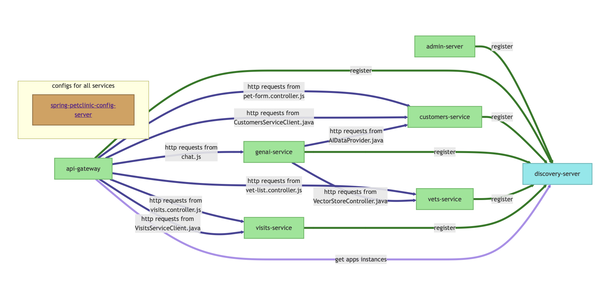

# Microservice interactions analyzing tool
[](https://github.com/p1onerka/microservices-diagrams/actions/workflows/CI.yml)
[](https://www.codefactor.io/repository/github/p1onerka/microservices-diagrams)

A tool for building diagrams of microservices' interactions based on the source code of an input project. It targets Spring applications: CodeQL queries look for an Eureka discovery server and its clients, a config server, load-balanced and plain REST calls on the Java side, and service names, config-server links and frontend HTTP requests on the JavaScript side. `generate-diagram.sh` creates Java and JavaScript CodeQL databases when they are missing, runs the queries and writes the results as CSV. Python scripts then map module directories to service names and turn the calls into a Mermaid diagram, where nodes are colored by role (discovery server, config server, Eureka client) and edges show registration, instance lookup and HTTP requests.

## Dependencies
Python 3.14. The diagram pipeline uses the standard library; the [CodeQL CLI](https://codeql.github.com/docs/codeql-cli/) is required to build databases and run the queries. Packages below are pinned in `requirements.txt` and cover tests, formatting and documentation:

- pytest 9.2.0
- pytest-cov 7.1.0
- black 26.10.1
- flake8 7.5.0
- sphinx 9.2.0
- sphinx-rtd-theme 3.1.0
- myst-parser 5.1.0

## How to run
Clone this repo:
```bash
    git clone git@github.com:p1onerka/microservices-diagrams.git
```
Open the project:
```bash
    cd microservices-diagrams
```
Run the project:
```bash
    ./generate-diagram.sh \<project_name\> \<project_dir\> \<java_db_name\> \<javascript_db_name\>
```

## Experiment
Run the OpenCode agent on one project (30 repetitions, metrics are written to `opencode-exp/`):
```bash
    ./opencode_exp.sh <project_path>
```
Run it over the project list. Set `PROJECTS_DIR` in `exp_launcher.sh` to the directory with the cloned projects first:
```bash
    ./exp_launcher.sh
```
The agent under test is selected by `AGENT_NAME` in `opencode_exp.sh` (`reading-agent` or `codeql-agent`).

## How to run tests
Install dependencies:
```bash
    pip install -r requirements.txt
```
And then run tests:
```bash
    python -m pytest
```

## Example diagram
Here is the example of tool's output with [this](https://github.com/spring-petclinic/spring-petclinic-microservices) project as input:

The source code for this diagram can be found in `tests/test_complex_diag_drawing.py`.

## Docs
Project documentation is availible [here](https://p1onerka.github.io/microservices-diagrams/index.html).

## Contacts
[Ksenia Kotelnikova](https://github.com/p1onerka)
